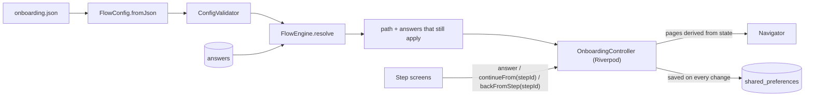

# Traininpink: config-driven onboarding

A personalised onboarding flow for Traininpink. A few questions, a plan built from her answers, and a paywall, in **English and Arabic**. It runs fully offline and nothing is really purchased.

It has its own visual identity: a dusty rose palette (pink, like the brand name) and a motion language built on *flow*, a nod to lymphatic drainage. A looping Pilates clip opens the app, photos sit above the key questions, soft colour drifts behind the reassurance screens, and the plan "fills up" like liquid while it's built.

The flow is driven by one JSON file. Adding a question, a branch, or a piece of the plan is a config change. Changing an earlier answer re-routes the rest of the flow and drops answers from paths she has left.

> Built and polished for **iPhone** (tested on the iPhone 17 Pro Max simulator). Android runs but has not had a polish pass.

---

## Quick start

```bash
flutter --version   # 3.41.0 stable (Dart 3.11)
flutter pub get
flutter run         # pick an iPhone simulator or a device
flutter test        # 55 tests: engine, config, controller, widgets
```

For judging feel on a real phone, `flutter run --release` gives release-mode animation timing.

---

## Try this in 60 seconds

1. **Build my plan**, type a name. Every later screen uses it.
2. Pick **Get back into training**. Two new questions appear and the progress bar eases *back*, because her path just got longer. Answer **A few months**.
3. Pick **An injury**. You get an injury branch, plus a reassurance screen that names the areas she picked.
4. **Long-press the progress bar** to open the flow inspector: every step in the config, whether it is on her path, and the rule that skipped it.
5. Finish. On the plan, tap **Why you stopped** and change it to **Life got busy**. You go straight back to the plan: the injury content is gone and the intensity changes from *Low impact* to *Moderate*.
6. Close the app mid-flow and reopen it. *"Welcome back, Layla"*, on the exact question.
7. Tap **ع** on any screen. Everything mirrors. Swipe from the right edge to go back.
8. Type `layla@gmial.com` at the email step.
9. Double-tap Continue as fast as you can. You move exactly one step.
10. On the paywall, switch plans. The trial timeline and the button text follow.

---

## What's in it

| | |
|---|---|
| **Config-driven steps** | Single choice, multi choice, free text (name, email) and info screens, all from `assets/config/onboarding.json` |
| **Branching** | Steps *and individual options* have `showIf` rules (`equals`, `in`, `includes`, `all`, `any`, `not`) |
| **Correct re-routing** | Going back and changing an answer drops every answer that no longer applies, including an option that disappeared ("5 days a week" after she says she rarely trains) |
| **Personalised plan** | Title, stats and highlights come from config rules over her answers. "Built from your answers" lists only steps on her path, each one tappable to edit |
| **Edit from the plan** | Changing an answer from the plan asks only the questions the change opened, then returns to the plan |
| **Email** | Validation shown on submit (never while typing), one-tap typo fix (`gmial.com` → `gmail.com`), email keyboard, autofill |
| **Paywall** | Plans from config, a clear selected state, honest "save %" (rounded down), trial timeline, AED pricing. Subscribing records the choice |
| **Resume** | Saved on every change, restored against the current config, with a "welcome back" greeting |
| **English + Arabic** | Full RTL, IBM Plex Sans Arabic, feminine forms, ICU plurals (including the Arabic dual), direction-aware motion |
| **Own visual identity** | Dusty rose palette defined in one tokens file (re-theming is a one-file change), Poppins and IBM Plex Sans Arabic |
| **Flow motion** | Muted looping welcome video, hero photos that settle in with the page, drifting colour behind info screens, a liquid fill while the plan builds |
| **iPhone details** | Native edge-swipe back, haptics, the keyboard never covers the field, reduced-motion support, text scaling up to 130% |

---

## Architecture



### Project structure

Feature-first, with one rule per folder, so every file has one obvious home:

```
lib/
├── main.dart                   load + validate config, open storage, run
├── app.dart                    MaterialApp, theme per language, config error screen
├── core/
│   ├── design/                 tokens, theme, AppAssets (every image/video path), focus mixin
│   │   └── widgets/            generic UI any app could use: button, card, pressable, motion
│   └── l10n/                   ARB files for app chrome, language controller
└── features/
    ├── onboarding/
    │   ├── domain/             the rules, pure Dart (no Flutter): config, conditions, FlowEngine, validator
    │   ├── data/               config loader, progress store
    │   ├── application/        state and logic, no widgets
    │   │   │                   OnboardingController owns the flow: answers, navigation, saving
    │   │   └── controllers/    one logic controller per page type (choice, text, tape, week)
    │   └── presentation/
    │       ├── screens/        whole pages: welcome, building, plan, flow shell
    │       ├── steps/          one view per step type + the shared step layout;
    │       │                   views keep only UI (animation, timers, haptics)
    │       └── widgets/        onboarding pieces: header, member card, tape, rhythm picker, body map…
    └── paywall/presentation/   paywall, success, price formatting
```

`test/` mirrors `lib/`.

**The rule that keeps branching safe:** the path is never stored. `FlowEngine.resolve(answers)` walks the config once. A step joins the path if its `showIf` holds against the answers *already kept*, and its own answer is kept only if it is still valid there. A stale answer can never steer the flow, and it is dropped from the result. `ConfigValidator` guarantees conditions only look *backwards*, so one pass is always enough and cycles are impossible.

---

## The config

Each step carries its own copy in both languages:

```json
{
  "id": "last_trained",
  "type": "single",
  "showIf": { "answer": "goal", "equals": "get_back_into_it" },
  "title": { "en": "How long since you last trained?", "ar": "منذ متى توقّفتِ عن التمرين؟" },
  "summaryLabel": { "en": "Last trained", "ar": "آخر تمرين" },
  "options": [
    { "id": "few_weeks", "label": { "en": "A few weeks", "ar": "بضعة أسابيع" } },
    { "id": "over_a_year", "label": { "en": "More than a year", "ar": "أكثر من سنة" } }
  ]
}
```

Any step can also name a photo, `"image": "goal.jpg"`, from `assets/images/steps/`. Pictures are content too, so they live in the config with the copy.

### Add a question in 30 seconds

Paste this after `goal` in `steps`. Nothing else changes:

```json
{
  "id": "sleep",
  "type": "single",
  "showIf": { "answer": "goal", "equals": "feel_lighter" },
  "title": { "en": "How well do you sleep, {name}?", "ar": "كيف هو نومكِ يا {name}؟" },
  "summaryLabel": { "en": "Sleep", "ar": "النوم" },
  "options": [
    { "id": "well", "label": { "en": "Pretty well", "ar": "جيد" } },
    { "id": "badly", "label": { "en": "Not great", "ar": "ليس جيداً" } }
  ]
}
```

To make the plan react to it, add a highlight with `"when": { "answer": "sleep", "equals": "badly" }`.

`{step_id}` placeholders are filled with her answer, and multi-choice answers are joined grammatically per language ("belly, legs and arms" / "البطن والساقين والذراعين").

### What the validator catches

Run on every launch (the app shows a readable error screen listing every problem) and in a test against the bundled file:

- a condition that refers to a later or unknown step, or an unknown option
- an operator that doesn't fit the step (`equals` on multi choice, `includes` on single choice)
- missing Arabic (or any listed language) copy
- a `{placeholder}` that isn't an earlier question
- duplicate ids, empty option lists, an invalid `minSelected`, an image that isn't a plain file name
- a plan without an unconditional fallback title
- a paywall with fewer than two plans, no trial, or a default plan that doesn't exist

---

## Key decisions

| Decision | Why | Trade-off |
|---|---|---|
| **Path derived, never stored** | One source of truth: answers. Nothing can drift when she edits | Re-resolving on every change (microseconds at this size) |
| **Abandoned branches are discarded, not hidden** | "No stale answers" holds for what we save and would send, not just what we show | If she flips back to a branch, she answers it again |
| **Conditions only look backwards** | One-pass resolution, no cycles, easy to reason about | A question can't depend on a later one, which onboarding never needs |
| **Question copy lives in the config** (app chrome in ARB) | Adding a question really is one file | Translators work in two places |
| **Sealed step types + exhaustive `switch`** | A new step type won't compile until it has a screen | Adding a type is a code change (adding a question isn't) |
| **One Riverpod `Notifier` owns state**; widgets send intents | Clear ownership; easy to test with fakes | |
| **Intents carry their origin** (`continueFrom(stepId)`) | A double tap, or a tap on a page sliding away, is ignored. No timers, no `isNavigating` flags | |
| **Navigator pages derived from state, as `CupertinoPage`s** | Native iOS swipe-back that mirrors in Arabic; navigation is just state changing | Pages under the current one stay mounted |
| **Header above the navigator** | The progress bar stays put and glides while questions slide underneath | |
| **Plan content in the config** | A new branch can change the plan it leads to without code | Plan rules are less flexible than code |
| **Saved progress re-validated against the current config** | A renamed option or a new question never breaks a returning member | Bumping `version` discards saved progress |
| **5 runtime dependencies** (`flutter_riverpod`, `shared_preferences`, `intl`, `meta`, `video_player`) | No go_router, freezed, lottie or google_fonts (which fetches at runtime and breaks offline). `video_player` is Flutter's official plugin and earns its place on the first screen | Slightly more hand-written code |
| **Our own palette, not theirs** | The brief asks for a flow that feels finished, not a copy of the current app. Dusty rose keeps the brand's "pink" while staying calm | A re-theme to their real brand is a one-file change in `tokens.dart` |
| **Motion built on "flow"** | One idea (gentle flow, never bounce) ties the video, the drifting backgrounds and the liquid fill together, and it suits a lymphatic drainage brand | More moving parts to keep calm. All of it stops under Reduce Motion |
| **Info screens educate rather than show testimonials** | Fabricated social proof in a demo is the wrong habit; this is where real member stories would go | Less persuasive than real testimonials |

---

## Arabic and RTL

- Layout uses `EdgeInsetsDirectional` and `AlignmentDirectional` throughout, and icons are direction-aware, so nothing is special-cased per language.
- **IBM Plex Sans Arabic** for Arabic, **Poppins** for Latin. Each falls back to the other, so an Arabic name in the English UI, or an email in the Arabic UI, still renders in a brand font.
- Arabic text gets taller line height and **no negative letter spacing**, which would break the joins of a cursive script.
- Copy addresses her in the **feminine** (أنتِ، اختاري). Plurals use ICU rules, including the dual ("تم اختيار اثنتين").
- Emails are always laid out left to right. A name field follows the script she types.
- Prices and dates use Western digits in Arabic, as Gulf apps and the App Store do. Currency is AED / د.إ.
- **Honest flag:** the Arabic copy was drafted with AI help and has not had a native copywriter's review yet. It should before shipping.

---

## Craft details

- **Double taps:** intents carry the step they came from, so stale ones are ignored.
- **Keyboard:** each question's scaffold resizes, so the CTA rides above the keyboard and the content scrolls. Focus is requested only *after* the page finishes sliding in.
- **Nothing jumps:** selection animates colour, never border width or font weight. Images are pre-cached at launch.
- **Motion:** one vocabulary (160 / 280 / 480 ms, ease-out). Staggered entrances are driven by the route animation, so they reverse on back and never replay. Everything collapses under *Reduce Motion*.
- **Video:** the welcome clip is muted, loops, fades in once its first frame is ready (no flash of a different image), plays only while the welcome screen is on top, and *mixes with other audio*, so opening the app never pauses her music. Under Reduce Motion it is replaced by a still photo.
- **Flow background:** radial gradients rather than blur filters, one ticker, its own repaint layer.
- **Haptics:** a selection click on choices, a light impact on Continue, a medium impact on subscribe and on an invalid email.
- **Accessibility:** semantics on cards (selected / checked / mutually exclusive), the progress bar ("Step 3 of 8") and icon buttons. Text scaling is supported up to 130%.

---

## Tests

| File | Proves |
|---|---|
| `flow_engine_test.dart` | Branching paths, **the brief's example** (leaving *get back into it* drops `last_trained` from path and plan), nested branches, option-level pruning, stale answers can't steer |
| `flow_invariants_test.dart` | **1,000 random members** walk the real config, going back and changing their minds. After every move: no stale answers, no dead ends, stable resolution, config order, plan copy fully filled. All 5 real paths explored |
| `config_validator_test.dart` | The bundled config is valid; each class of mistake is reported with its location |
| `onboarding_controller_test.dart` | Double tap moves one step, back keeps answers, resume after restart, version mismatch, edit-from-plan re-routing, subscription recorded, funnel events |
| `email_address_test.dart` | Validation and typo suggestions, including not "fixing" real domains like `mail.com` |
| `app_test.dart` | App boots into the flow, Arabic is RTL, resume greeting, every config icon and image exists |

CI (`.github/workflows/ci.yml`) runs formatting, `flutter analyze --fatal-infos` and the tests.

---

## What I cut, and why

- **Dark mode:** their app is light, and it would double the design QA in the timebox.
- **Real purchases** (StoreKit / RevenueCat): out of scope by the brief.
- **Remote config and experiment assignment:** the config is bundled and versioned, ready to be fetched.
- **Analytics backend:** events go through one function (`onboarding.analytics` in the console). Swapping in Amplitude or Firebase is a one-line provider override.
- **Android polish pass, golden tests, Lottie:** time went to the flow, RTL and the branching guarantees instead.
- **Matching Traininpink's exact look:** deliberately not done. The palette is ours, and the real brand can be dropped into `tokens.dart`.

## What I'd do next

1. Fetch the config remotely, with experiment assignment, so product can ship flow changes without a release.
2. Make the paywall's position a config step, so placement can be A/B tested (see answer 1).
3. Native Arabic copy review and Gulf-specific options (e.g. a Ramadan-friendly schedule).
4. Sign in with Apple at the email step (see answer 2).
5. Golden tests for every step type in EN and AR.
6. A tiny tool that renders the config as a flow diagram for product reviews.

---

## The two questions

### 1. Where would you put the paywall, and why? How would you find out whether you were right?

**Right after the plan reveal**, which is where it is.

At that point she has invested a few minutes, told us what matters to her, and just watched a plan assemble around her answers. The paywall then sells *her plan* ("Your plan is waiting, Layla"), not an app. Earlier and she pays for a promise. Later (e.g. after a free session) can win on trust, but it splits attention and loses the momentum of the reveal. The close button stays: a soft paywall respects her, and she can still edit the plan.

**How I'd know:** an A/B test on placement (before the plan, after the plan, after a first free session). The flow is config-driven, so the variants are configs, not branches of code. The decision metric is **revenue per onboarding start, including trial-to-paid conversion and early refunds/cancellations**, not paywall views or even trial starts, which a more aggressive placement can inflate. Guardrails: onboarding completion and 30-day retention. I'd read results per segment as well (goal branch, Arabic vs English), since different paths may want different placements.

### 2. What would you instrument to learn where people drop out, and what is the first thing you would change if the data showed a cliff at the email step?

**Instrument:** `step_viewed`, `step_completed` and `step_back`, keyed by **step id** (not index, because paths differ), with path length, branch, language and time on step. Also: app backgrounded mid-step, resume, edits from the plan, paywall viewed / plan selected / subscribed, and for email specifically, invalid submit attempts and whether the typo suggestion was shown and accepted. Most of this is already emitted by the controller (`onboarding.analytics`).

**First change for an email cliff:** first find out *which* cliff it is. Many invalid attempts means friction. Abandoning without typing means reluctance. For reluctance, the first experiment I'd ship is **moving email after the plan reveal, framed as "Save my plan"**: the value exchange becomes concrete, and she has already seen what she gets. Next I'd add **Sign in with Apple** (one tap, and private relay respects members who don't want to share an address). For friction, the inline typo fix is already in place, and I'd look at the keyboard and autofill data next. Because the order lives in the config, each of these is a config variant behind an experiment.

---

## Assumptions

- iPhone first, portrait only. Light mode, matching the current Traininpink app.
- Name and email are required. Nothing is sent anywhere: there is no backend.
- Changing an answer that closes a branch discards that branch's answers rather than remembering them.
- "Subscribing just records the choice": the plan id and timestamp are saved locally, and the success screen shows the trial end date.

## Credits

- Photos from [Unsplash](https://unsplash.com) under the Unsplash License: Roxana Popovici (plan, fallback welcome), Sẹ́gun Toríọlá (paywall; the orange backdrop was moved onto our palette with Apple Vision person segmentation, the woman untouched, see `tool/recolor_background.swift`), Look Studio (success), bruce mars (goal), Vitaly Gariev (injury), rajat sarki (postnatal), Glenna Haug (feel lighter), Dane Wetton (session length).
- Waist render: a 3D image generated with AI for this project.
- Welcome video from [Pexels](https://www.pexels.com/video/woman-stretching-in-a-kneeling-position-4608976/) under the Pexels License.
- Fonts: [Poppins](https://fonts.google.com/specimen/Poppins) and [IBM Plex Sans Arabic](https://fonts.google.com/specimen/IBM+Plex+Sans+Arabic) under the SIL Open Font License (licence texts in `assets/fonts/`).
- AI assistance is described in [AI_USAGE.md](AI_USAGE.md).
